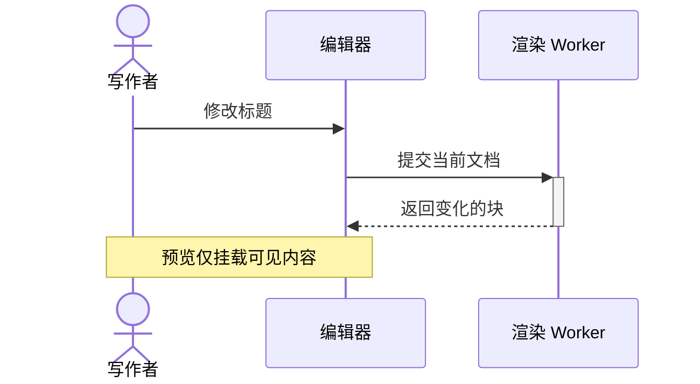
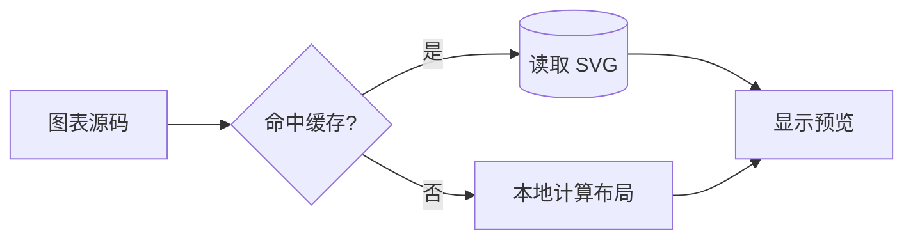
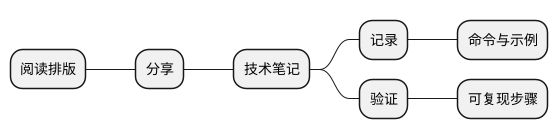
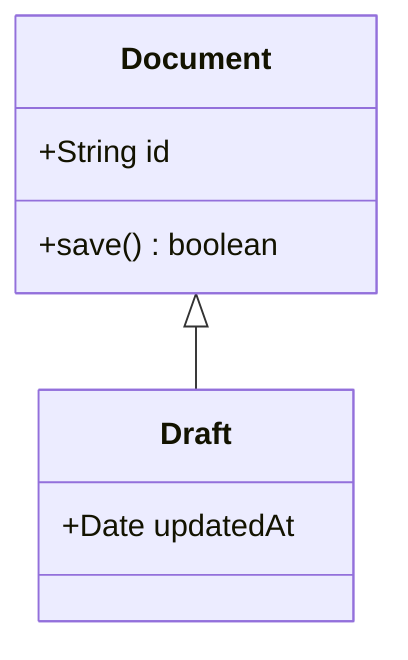
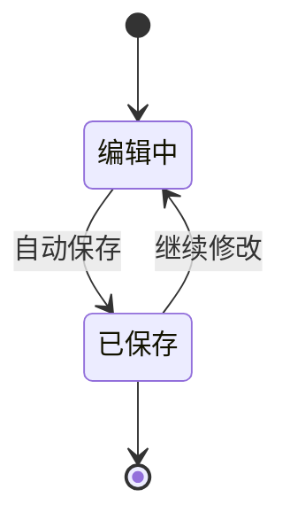
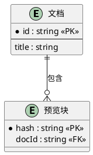
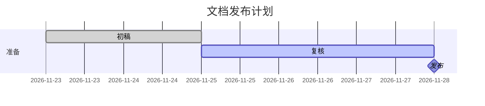
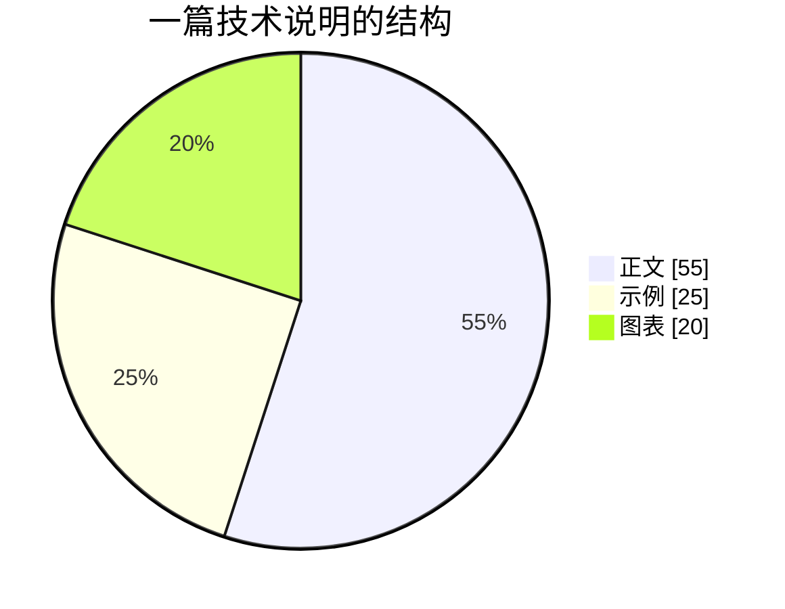

# 用 Markdown 写清楚一件事

欢迎来到 MDRenderTool。左边记录原始想法，右边检查成稿。用大纲跳到任一章节，或把本地 Markdown 文件拖进编辑器。修改会自动保存为当前浏览器的草稿。[^local]

| 操作 | 快捷键 |
| --- | --- |
| 打开文件 | Ctrl / Cmd + O |
| 保存文件 | Ctrl / Cmd + S |
| 切换视图 | Ctrl / Cmd + Shift + P |
| 显示或隐藏侧栏 | Ctrl / Cmd + \\ |

- [x] 检查标题、表格与脚注
- [ ] 试着修改一个节点，观察预览

## 编辑到预览

### 时序图



### 流程图



### 思维导图



## 描述数据与状态

### 类图



### 状态图



### 实体关系图



## 计划与复盘

### 甘特图



### 饼图



## 公式和代码

行内式 $E=mc^2$，块级式如下。

$$
\sum_{k=1}^{n} k = \frac{n(n+1)}{2}
$$

```ts
const title = "本地 Markdown";
const digest = await crypto.subtle.digest("SHA-256", new TextEncoder().encode(title));
console.log(new Uint8Array(digest));
```

[^local]: 草稿与界面偏好写入当前浏览器的 IndexedDB。使用「保存」可另外生成可携带的 Markdown 文件。
